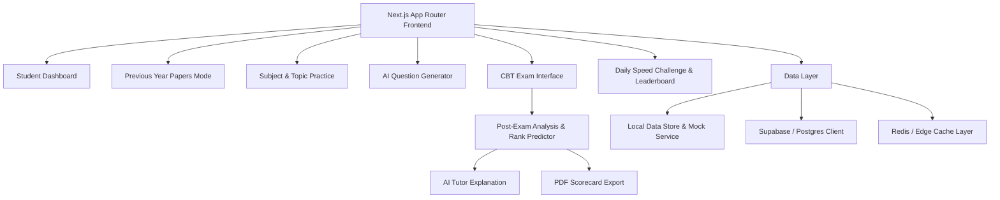

# Implementation Plan: AP/TS EAMCET High-Performance Exam Portal

Build an ultra-fast, responsive, production-ready online exam portal tailored specifically for AP EAMCET and TS EAMCET engineering and agriculture aspirants. The platform delivers an authentic CBT exam simulation, rich analytics, AI-powered tutoring, KaTeX mathematical typesetting, bilingual (English & Telugu) support, and gamified practice.

---

## User Review Required

> [!IMPORTANT]
> - **Framework & Runtime**: The app will be built with **Next.js (App Router)**, **TypeScript**, and **Tailwind CSS**.
> - **Database & Cache**: We provide production-ready **Supabase / PostgreSQL SQL schema migrations** (`supabase/schema.sql`) and Redis caching utilities. For immediate zero-setup local execution, the portal includes an automatic local storage / in-memory database mock provider so the entire application runs smoothly out of the box without requiring external API keys.
> - **AI Integration**: Gemini API client integration is provided for the **AI Question Generator** and **AI Tutor ("Explain with AI")**. When an API key (`GEMINI_API_KEY`) is not configured, high-quality simulated intelligent responses and fallback generators will activate automatically.

---

## Proposed Architecture & Modules

---

## Proposed Changes

### Project Initialization & Core Configuration
- Initialize Next.js project with App Router, TypeScript, and Tailwind CSS.
- Install essential dependencies: `katex` (formula rendering), `lucide-react` (icons), `canvas-confetti` (gamification feedback), `@google/genai` (AI tutoring & generation).
- Configure modern design tokens, color palettes (slate, indigo, emerald, amber, rose), and typography in `tailwind.config.js` and `app/globals.css`.

### Database Schema & Backend Contracts
#### [NEW] [schema.sql](file:///d:/Projects/EAMCET/supabase/schema.sql)
- Defines tables specified in prompt:
  - `users` (`user_id`, `name`, `email`, `auth_provider`, `created_at`)
  - `questions` (`question_id`, `subject`, `topic`, `question_text_en`, `question_text_te`, `options_en`, `options_te`, `correct_option`, `explanation_en`, `explanation_te`, `is_previous_year`, `state`, `year`, `shift`, `difficulty`, `image_url`)
  - `test_attempts` (`attempt_id`, `user_id`, `test_type`, `total_score`, `subject_scores`, `user_answers`, `time_taken`, `rank_estimate`, `created_at`)
  - `user_gamification` (`user_id`, `streak_count`, `last_active_date`, `total_questions_solved`, `badges_earned`)
- Includes indexes on `(state, year, stream, shift)` and RLS policies.

#### [NEW] [types/index.ts](file:///d:/Projects/EAMCET/types/index.ts)
- TypeScript definitions for all domain entities, question states (`ANSWERED`, `NOT_ANSWERED`, `NOT_VISITED`, `MARKED_FOR_REVIEW`, `ANSWERED_AND_MARKED_FOR_REVIEW`), test config, and analytics.

#### [NEW] [lib/data/sampleQuestions.ts](file:///d:/Projects/EAMCET/lib/data/sampleQuestions.ts)
- Comprehensive realistic AP/TS EAMCET question bank covering Mathematics, Physics, and Chemistry with KaTeX equations (calculus, matrices, vectors, kinematics, optics, stoichiometry, organic mechanisms) and bilingual English + Telugu text.

#### [NEW] [lib/storage.ts](file:///d:/Projects/EAMCET/lib/storage.ts)
- Dual-mode data access layer supporting seamless local offline operation (Local Storage persistence) and remote Supabase syncing.

---

### Core UI Components & Math Engine
#### [NEW] [components/MathRenderer.tsx](file:///d:/Projects/EAMCET/components/MathRenderer.tsx)
- High-speed KaTeX inline (`$...$`) and block (`$$...$$`) mathematical equation renderer with graceful fallback.

#### [NEW] [components/Navbar.tsx](file:///d:/Projects/EAMCET/components/Navbar.tsx) & [components/Footer.tsx](file:///d:/Projects/EAMCET/components/Footer.tsx)
- Navigation bar with quick links (Dashboard, PYQ Papers, Topic Practice, Speed Sprint, AI Generator), streak counter, and bilingual indicator.

#### [NEW] [components/AdBanner.tsx](file:///d:/Projects/EAMCET/components/AdBanner.tsx)
- AdSense-compliant responsive banner component with placeholder preview modes for dashboard/analysis pages. Strictly excluded from CBT exam screens.

---

### CBT Exam Interface (Authentic AP/TS EAMCET Simulation)
#### [NEW] [app/exam/[id]/page.tsx](file:///d:/Projects/EAMCET/app/exam/[id]/page.tsx)
- **Exam Header**:
  - Live 180-minute countdown timer with color warnings (pulsing red under 5 minutes).
  - Candidate profile badge with avatar and exam roll details.
  - Bilingual switcher: toggle between English and Telugu on the fly.
  - Section Switcher Tabs: Mathematics (Q1-80), Physics (Q81-120), Chemistry (Q121-160).
- **Question Board**:
  - Clear question header with Subject, Section, Question Number, Marks (+1, 0).
  - KaTeX mathematical and chemical equation rendering in both languages.
  - 4 styled options with radio controls and keyboard shortcuts (1, 2, 3, 4).
- **Exam Controls Footer**:
  - `Save & Next` (saves answer as Answered [Green] and moves to next).
  - `Clear Response` (clears answer, sets to Not Answered [Red]).
  - `Mark for Review & Next` (sets to Marked for Review [Purple]).
  - `Save & Mark for Review` (sets to Answered & Marked for Review [Purple with Green Dot]).
  - `Previous` and `Next` navigation.
- **Collapsible Palette (Right Sidebar)**:
  - Official 5-status legend counters.
  - 160-question interactive grid with instant jumping and status indicators.
  - "Question Paper" popup view showing entire test at a glance.
  - "Instructions" popup modal.
  - "Submit Test" button triggering a confirmation summary modal (showing answered vs unanswered tally) before final score calculation.

---

### Post-Exam Analysis & Rank Predictor
#### [NEW] [app/analysis/[attemptId]/page.tsx](file:///d:/Projects/EAMCET/app/analysis/[attemptId]/page.tsx)
- **Score Breakdown**:
  - Total marks out of 160, accuracy %, speed (minutes/question).
  - EAMCET Rank Predictor based on empirical AP/TS marks-vs-rank data:
    - 140+ marks: Predicted Rank 1 - 500 (Top Tier Universities: JNTUH, OU, AU)
    - 120 - 139: Predicted Rank 501 - 2,500
    - 100 - 119: Predicted Rank 2,501 - 8,000
    - 80 - 99: Predicted Rank 8,001 - 20,000
    - 60 - 79: Predicted Rank 20,001 - 45,000
    - Below 60: Predicted Rank 45,000+
  - Subject-wise comparison cards (Maths vs Physics vs Chemistry).
- **Question-by-Question Review**:
  - Filter by Correct, Incorrect, Unattempted, Marked for Review.
  - Full step-by-step KaTeX explanations in English and Telugu.
  - "Explain with AI Tutor" interactive assistant modal explaining underlying concepts, shortcut tricks, and standard pitfalls.
- **Export**:
  - Printable Scorecard & PDF Export button with print-optimized CSS.

---

### Dashboard, Previous Year Papers & Practice Modes
#### [NEW] [app/page.tsx](file:///d:/Projects/EAMCET/app/page.tsx)
- Student Dashboard featuring:
  - Quick launch for Daily 10-Question Speed Sprint.
  - Performance analytics (accuracy trend, subject mastery progress bars).
  - Recent test history with quick links to scorecards.
  - Bookmarked questions drawer.
  - Streak tracker and earned achievement badges.
#### [NEW] [app/previous-years/page.tsx](file:///d:/Projects/EAMCET/app/previous-years/page.tsx)
- Filterable catalog of previous year exams: State (AP / TS), Year (2018 - 2026), Stream (Engineering - MPC / Agriculture & Pharmacy - BiPC), Shift (Morning Shift 1 / Afternoon Shift 2).
#### [NEW] [app/practice/page.tsx](file:///d:/Projects/EAMCET/app/practice/page.tsx)
- Custom topic test generator: select Subject, select Topics (e.g., Calculus, Conic Sections, Kinematics, Organic Chemistry), select number of questions, difficulty (Easy, Medium, Hard), and timed mode.
#### [NEW] [app/speed-challenge/page.tsx](file:///d:/Projects/EAMCET/app/speed-challenge/page.tsx)
- Daily 10-Question Speed Challenge with a 5-minute timer, instant rank on daily leaderboard, and streak increments.
#### [NEW] [app/ai-generator/page.tsx](file:///d:/Projects/EAMCET/app/ai-generator/page.tsx)
- AI Question Generator interface to create fresh, custom AP/TS EAMCET questions on demand with KaTeX formatting and Telugu translations.

---

## Verification Plan

### Automated Build & Lint Verification
- Initialize repository and install dependencies cleanly.
- Run `npm run build` to verify type safety, route resolution, and zero build errors.

### Manual Verification Flow
- **Dashboard**: Verify stats, streak counter, badges, and navigation.
- **Previous Year Papers**: Filter by AP/TS, Year, Stream, and start an exam.
- **CBT Exam Engine**:
  - Verify KaTeX mathematical and chemical equation rendering.
  - Verify bilingual toggle switches question and option text between English and Telugu immediately.
  - Verify all 5 state colors update correctly in the Question Palette upon Save & Next, Clear, and Mark for Review.
  - Verify timer countdown and warning states.
  - Verify Submit modal displays accurate tallies.
- **Post-Exam Analysis**:
  - Verify marks calculation (out of 160), subject scores, and Rank Predictor.
  - Test "Explain with AI Tutor" modal on difficult questions.
  - Test Print/PDF export preview.
- **AdSense Verification**:
  - Confirm non-exam pages display responsive banner placements.
  - Confirm CBT exam interface has absolutely zero ad clutter.
